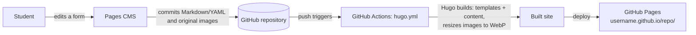

# Alexander — design and maintenance guide

Version 0.6.4 · snapshot of 22 November 2026 · Garrison LeMasters (ETBD, Miami University), with Claude

*In the starter template (`AlexanderTemplate`), the maintainer files this guide mentions, `CLAUDE.md` and the test scripts in `dev/`, are left out. They are kept in the maintainer's copy.*

Alexander is a Hugo theme and site template for undergraduate games students' portfolios. Students edit through Pages CMS; GitHub Actions builds with Hugo; GitHub Pages publishes. This guide records how it works, why it is built this way, what has and has not been tested, and how to change it.

Contents

1. Status
2. How a save becomes a web page
3. File map
4. Content format (the contract between content and design)
5. How the pages are assembled
6. Design decisions and rationale
7. Standards applied
8. Browser support and fallbacks
9. Testing
10. How to change things
11. Known limitations and open questions
12. History
13. Credits and licences

---

## 1. Status

| Area | State |
|---|---|
| Hugo build (0.147.0 extended), at a subfolder address | **Tested locally**: clean, no warnings |
| Layout, menu, sticky header, accessibility checks in Chrome (390, 700, 1440 px) | **Tested locally**: all checks in `dev/check_site.py` pass |
| Empty sections disappear from page and menu | **Tested locally** |
| Project layout for 1, 2, 3, 4, 5 and 7 projects, at laptop and phone widths | **Tested locally** (0.2.0) |
| AI opt-out tags and robots.txt (on and off), structured data, sitemap | **Tested locally** (0.2.0): output checked; JSON-LD parses |
| Colour schemes (both) | **Tested locally** (0.2.0): contrast of every pairing (`dev/check_palettes.py`); each scheme built and rendered in Chrome |
| Typeface choice (four pairings and an invalid value) | **Tested locally** |
| Font regeneration (`dev/build_fonts.py`) | **Tested**: reproduces the shipped font files exactly |
| GitHub Actions build and deploy | **Tested on GitHub** (21 Nov, demo repository `LeMasters/portfolio_DrPhill02`): builds and publishes within a minute or two of a save |
| Gallery: page, image pages, menu link only with content, phone and laptop widths | **Tested locally** (0.2.0) |
| Gallery on the home page (0.4.0): ticked images in Order; first five when none ticked; "See the full gallery" card; no section without images; menu marks Gallery current on gallery pages | **Tested locally**, **on GitHub** and **in Pages CMS** (21 Nov): ticking and unticking images changes the section as described |
| `.pages.yml` and content files parse; every content key has a form field | **Tested locally** (`dev/check_content.py`) |
| Analytics script: NONE, GoatCounter and Cloudflare, with codes typed, as addresses, as pasted snippets and unrecognised; absent from local previews | **Tested locally** (build output) |
| Analytics with real GoatCounter and Cloudflare accounts | **Not yet tested** |
| Pages CMS forms | **Tested in Pages CMS** (21 Nov): all seven forms of 0.4.0. Profile, Projects (edit and create), Gallery (edit, create, "Show on home page"), Experience, Education, Tools, Appearance. The Experience form's project dropdown saves correctly but is awkward to use (section 11). The eighth form, Analytics (0.5.0), **not yet tested** there |
| Experience section (0.3.0): entries, organization link, related-project link, menu button, empty section hidden, link omitted when the chosen project no longer exists | **Tested locally**, **on GitHub** and **in Pages CMS** (21 Nov) |
| Pages CMS image uploads flowing into Hugo image processing | **Tested on GitHub** (21 Nov): uploads land in `static/images/` with their original names, are referenced as `images/…`, and are published as resized WebP copies |
| Readable published image names (0.2.1) | **Tested on GitHub** (21 Nov): every image on the home page and the sharing image load under their new names |
| Section labels (0.5.0): visible Projects label; all labels larger, left-aligned; space at the end of each section | **Tested locally** and **on GitHub** (21 Nov) |
| Project kinds (0.5.0): case study, project, brief; home-page layout for each mix (no case studies, one, two; case study + one project; two projects + briefs; briefs only); case-study contents list; "Heading 1" in a description becoming `<h2>` | **Tested locally** (21 Nov). Kind field **used in Pages CMS** by Garrison (21–22 Nov: a project set to Case study and saved) |
| Sections (0.5.0–0.6.0): picture-and-text rows alternating sides; stacked when narrow; picture shrunk to its text's height; rules between; headings in the contents list; seven suggested headings in a new project's form; a click opens the section in a dialog | **Tested locally** (1440 and 390 px, dialog with and without script) and **on GitHub** (22 Nov). **Used in Pages CMS** by Garrison (21–22 Nov: a case study with sections and pictures uploaded inside them, saved repeatedly). Not yet confirmed: the seven suggested headings appearing in a new project's form |
| Analytics form (0.5.0): service, code, AI-training choice, Search Console code in `data/analytics.yaml`; Profile without them | **Tested locally** and **on GitHub** (21 Nov). In Pages CMS **not yet tested** |
| Case-study page (0.6.0): one column; label above an outlined box holding title, caption and description; facts and contents; image; title repeated before the Sections | **Tested locally** (1440 and 390 px) and **on GitHub** (22 Nov); looked at by Garrison on the live site |
| Form order and labels (0.6.0): Profile (About and Résumé under Area of expertise; "Custom Links"); Projects in page order; "Alt text" | **On GitHub** (22 Nov); `dev/check_content.py` passes. Profile order checked by Garrison in Pages CMS |
| Gallery titles (0.6.2): visible title under each thumbnail, inside the link; link name = alt text, then title; empty alt read as the title once; titles clamp to two lines; "See the full gallery" tile square and level | **Tested locally** (390 and 1440 px; a build with every alt removed) and **on GitHub** (22 Nov build). Looked at on the live site: **not yet** |
| Wide cards (0.6.3): an image squarer than 1.4:1 shown whole on a tinted band; 3:2 and wider still fill the frame; form hint and README describe the crop | **Tested locally** (portrait sample at 390 and 1440 px; a build with a 3:2 image keeps the crop; `dev/check_site.py` passes) and **on GitHub** (22 Nov build). Looked at on the live site: **not yet** |
| Other browsers (Safari, Firefox), real phones | **Not yet tested** |

**0.5.0 (21 Nov)** added project kinds, larger section labels, picture-and-text Sections and an eighth form, Analytics. **0.6.0 (22 Nov) closes this series**: the case-study page reworked in one column (outlined intro box, the title repeated before the Sections); Sections pictures shrunk whole to their text's height, rules between sections, and a click opening each section in a dialog; seven suggested section headings; forms reordered to follow the page; "Alt text" labels. Snapshot: `DrPhill-0.6.0.zip` (template with sample content). Carried forward: the Experience dropdown's position in the form and a workaround for its behaviour (section 11); the Analytics form and the suggested headings confirmed in Pages CMS; real phones, Safari and Firefox (the section dialog included); neutral sample content and the student-path rehearsal before the template goes to students. Open: whether to limit the number of case studies; a crop anchor for wide cards, in reserve since 0.6.3 (section 11).

**0.6.1–0.6.4 (22 Nov)**, after the series closed: project pages in the outlined box and briefs without Sections; "Built Month Year" in the small print; the rename to Alexander; visible titles under gallery thumbnails; squarer images shown whole on wide cards; a consistency pass on the docs, with every typography value and the dialog backdrop moved into CSS settings (no visible change). Snapshots: `Alexander-0.6.1.zip` and the empty `Alexander-template-0.6.1.zip`; at 0.6.4, `AlexanderTemplate.zip` (22 Nov): the bare starter for faculty review (no content; keeps `docs/`, leaves out `dev/` and `CLAUDE.md`; README adds setup steps), built locally, not yet on GitHub.

Student guides written alongside 0.2.0 (Claude Docs): *Your Portfolio, Search Engines and AI*; *How to Set Up Your Own Domain Name* (Cloudflare); *Guidelines for Setting Up Your First Portfolio*.

A clickable preview of the sample site exists as a private Claude artifact ("Alexander – preview"). It was built with relative links so it works as an artifact; that variation is not part of the source.

---

## 2. How a save becomes a web page



- **Pages CMS** is only an editor. It never runs Hugo. It commits the student's files (and original uploads) to the repository.
- **GitHub Actions** runs `.github/workflows/hugo.yml` on every push: installs Hugo 0.147.0 extended, builds with `--baseURL` set to the Pages address, uploads the result.
- **GitHub Pages** serves the result. The built site is never committed back; the repository holds only what students made, plus the theme.
- A failed build leaves the previous site live. A successful one is public within a minute or two.

### What happens on each save, step by step

Hugo is a *static-site generator*: a program that reads a folder of text files and templates and writes out a finished website (plain HTML, CSS and images). It runs only at build time, on GitHub's machines. Nothing runs on the published site itself, which is why it is fast, cheap and hard to break. Here is everything that happens between a student clicking **Save** and the change appearing.

**1. In Pages CMS (seconds)**

- The form is checked: required fields (such as a project title) must be filled in.
- The whole file is rewritten from the form, in the form's field order. Text loses unnecessary quotation marks, comments in the file are deleted, and **empty fields are removed from the file** (the templates treat a missing field as empty, so nothing changes on the site).
- Keys that have no field in `.pages.yml` are dropped. That is why every key has a field (section 4, "Rules"). Pages CMS can merge instead (`settings: content: merge: true`); not switched on.
- An uploaded image is committed at once, under its original name, to `static/images/`, as its own commit ("Create static/images/… (via Pages CMS)").
- The save becomes one commit to the `main` branch ("Update content/projects/… (via Pages CMS)"). That commit is the whole of what Pages CMS does. Every earlier version stays in the repository's history.

**2. In GitHub Actions (about a minute)**

The push to `main` starts the workflow in `.github/workflows/hugo.yml`. Its progress and any errors are visible in the repository's **Actions** tab.

1. A fresh Linux machine copies the repository.
2. It installs Hugo 0.147.0 (extended edition, which includes WebP support). The version is pinned so a Hugo update can never change a student's site unannounced.
3. It asks GitHub for the site's address (`username.github.io/repo/`).
4. It runs `hugo --minify` with that address (step 3 below).
5. It uploads the finished folder (`public/`) to GitHub Pages, which publishes it.

Saves made in quick succession each start a run. Runs wait their turn rather than cancelling each other, so the last save wins. If a run fails, the previous site stays live and the Actions tab shows a red ✗.

**3. Inside the Hugo build (a few seconds)**

1. **Settings.** Hugo reads `hugo.toml`: the theme's name, which kinds of page to skip (no tag pages, no RSS), and the folder arrangement. `static/images/` is handed to Hugo's image processing, and the originals are excluded from the published site.
2. **Content.** Hugo reads each Markdown file. The part between the `---` lines (front matter) becomes data the templates can use: title, caption, image, order and so on. The text below becomes HTML; images and links typed inside that text go through the same image and link handling as form fields (the "render hooks"). `data/tools.yaml`, `data/style.yaml` and `data/analytics.yaml` are read as data.
3. **Deciding what exists.** `partials/sections.html` lists the sections that have content. Both the menu and the home page are drawn from that list. Projects are sorted by Order (a project with no Order goes last) and laid out by how many there are (section 5).
4. **Pages.** Hugo writes one HTML file per page: home page, one page per project, the Gallery page and one page per gallery image, an unlinked All projects page, and a 404 page. Education entries feed the home page and get no pages of their own.
5. **Images.** For every JPEG, PNG or WebP image the site uses (`partials/img.html`):
   - phone photos are turned upright using their orientation data;
   - copies are made in WebP format at 480, 800, 1200, 1600 and 2000 pixels wide (never wider than the original), at quality 80 with a high-quality resampling filter. A 2.6 MB PNG typically becomes about 50 KB at 1200 px;
   - the copies are given readable names: the original's name with spaces and other unusual characters turned into underscores, plus the width (`Catbug cartoon still.png` → `Catbug_cartoon_still-800w.webp`);
   - each `` tag lists every copy with its width, so a phone downloads a small one and a large screen a large one, and states the image's width and height so the page doesn't jump while loading;
   - for sharing previews (links pasted into Slack, LinkedIn, Discord), a 1200 × 630 JPEG crop is made (`…-share.jpg`).
   GIF and SVG images are published unchanged. Processed images are cached between local builds, but not between GitHub builds, so each GitHub build redoes them (a few seconds).
6. **Styles and fonts.** The two stylesheets are joined into one file, minified, and given a fingerprint (a code in the file name that changes whenever the styles change, so browsers never use an outdated copy). The theme's font files are copied as they are.
7. **Page details.** Into each page's `<head>` go the title and description, the canonical address, sharing-preview tags, schema.org structured data (`Person` on the home page, `CreativeWork` on project pages), the AI-training opt-out tags (unless the student allowed training), a Search Console verification tag (if given), and the visitor-statistics script (only if the student chose a service).
8. **Site files.** `sitemap.xml` (for search engines) and `robots.txt` (AI-training opt-out and sitemap address) are written.
9. **Minifying.** Unneeded spaces and line breaks are removed from the HTML to make pages smaller.
10. **Output.** Everything goes into `public/`, which GitHub Actions publishes. Nothing is written back to the repository.

**4. In the visitor's browser**

GitHub Pages lets browsers keep a copy of each page for up to ten minutes. Someone who looked at the site just before a save may see the old version until they refresh. The README tells students so.

---

## 3. File map

```
Alexander/                                  ← one repository per student (copied from the template)
├── README.md                             student-facing: how to edit, where content lives
├── CLAUDE.md                             instructions for Claude when maintaining the theme
├── hugo.toml                             site settings, image mounts, experience/education cascade
├── .pages.yml                            the eight Pages CMS forms
├── .github/workflows/hugo.yml            build + deploy on every push (Hugo pinned)
├── .gitignore
│
├── content/                              ── STUDENT CONTENT (portable Markdown) ──
│   ├── _index.md                         Profile: name, expertise, email, linkedin, github, links, resume; body = About
│   ├── projects/*.md                     one per project; body = description; each gets its own page
│   ├── gallery/*.md                      one per image; body = caption; each gets its own page
│   ├── experience/*.md                   one per job; body = optional detail; no pages of their own
│   └── education/*.md                    one per degree; body = optional detail; no pages of their own
├── data/
│   ├── tools.yaml                        list of {name, note}
│   ├── style.yaml                        {palette, text, titles}: colour scheme and typefaces (appearance, not content)
│   └── analytics.yaml                    {service, code, aiTraining, googleVerification}: settings, not content
├── static/
│   ├── images/                           uploads (originals; only resized copies are published)
│   └── files/                            résumé etc.
│
├── themes/Alexander/                       ── DESIGN (the same for every student) ──
│   ├── theme.toml, LICENSE               name, version, MIT licence (fonts excluded)
│   ├── assets/css/
│   │   ├── main.css                      all styles; numbered contents; settings in section 1
│   │   └── fonts.css                     @font-face rules (generated by dev/build_fonts.py)
│   ├── static/fonts/<key>/               WOFF2 files + OFL.txt for atkinson, inter, source-serif, fraunces
│   └── layouts/
│       ├── _default/baseof.html          page shell: <head>, typeface choice, CSS, skip link, script
│       ├── _default/single.html, list.html               fallback pages
│       ├── 404.html                      page-not-found page
│       ├── _default/_markup/render-image.html            images in Markdown → responsive image
│       ├── _default/_markup/render-link.html             links in Markdown → repaired addresses
│       ├── _default/_markup/render-heading.html          headings in Markdown: "Heading 1" → <h2>
│       ├── index.html                    home page: projects, then sections
│       ├── projects/single.html          a project's page, laid out by its kind
│       ├── projects/list.html            All projects page (exists, not linked from the home page since 0.2.0)
│       ├── gallery/list.html             Gallery page: square thumbnails with titles
│       ├── gallery/single.html           one image, whole, with title and caption
│       ├── robots.txt                    AI-training opt-out + sitemap address (published as /robots.txt)
│       └── partials/
│           ├── sections.html             ★ which sections exist (drives page AND menu)
│           ├── masthead.html             sticky header: name, menu, expertise
│           ├── name-lines.html           splits the name into two even rows for the header
│           ├── nav.html                  section menu (row on wide screens, Menu button on narrow)
│           ├── project-card.html         image + title + caption card; wide cards show squarer images whole
│           ├── project-sections.html     a project's Sections: picture and text rows, alternating sides; each opens in a dialog
│           ├── img-full.html             address of an image's largest published copy (a Sections picture's link without script)
│           ├── project-kind.html         a project's kind: case-study, project or brief
│           ├── project-groups.html       projects grouped by kind, in home-page order
│           ├── gallery-items.html        gallery entries that have an image, in order
│           ├── section-gallery.html      home-page Gallery section: chosen thumbnails + "See the full gallery" card
│           ├── pager.html                previous / next links (project and gallery pages)
│           ├── section-experience.html, section-education.html, section-tools.html, section-about.html, section-contact.html
│           ├── experience-entries.html   experience entries that have content, in order
│           ├── education-entries.html    education entries that have content, in order
│           ├── bottom-block.html         closing block: name, expertise, contact links
│           ├── analytics.html            optional GoatCounter or Cloudflare script (Analytics form)
│           ├── img.html                  ★ every image: WebP srcset, sizes, width/height, lazy
│           ├── img-name.html             readable names for published image copies
│           └── url.html                  ★ every link: adds https://, fixes subfolder paths
│
├── docs/DESIGN.md                        this guide
└── dev/                                  maintainer tools (not used by the build)
    ├── check_site.py                     browser checks (Playwright + Chrome)
    ├── check_content.py                  .pages.yml and content files parse; every key has a form field
    ├── check_palettes.py                 contrast check of every colour scheme, read from main.css
    ├── build_fonts.py                    regenerate fonts from Fontsource
    └── make_placeholders.py              regenerate the labelled sample images
```

★ = the three partials most other templates depend on.

---

## 4. Content format (the contract between content and design)

The design reads these files and fields. A future theme can replace `themes/Alexander/` entirely; as long as it reads the same fields, no student content and no Pages CMS form has to change.

### `content/_index.md` (Profile form)

| Field | Type | Notes |
|---|---|---|
| `name` | string, required | Header, browser tab, favicon initials, bottom block |
| `expertise` | string | One line under the name; also the page description |
| `email` | string | Contact section and bottom block |
| `linkedin` | string (URL) | Menu button (opens LinkedIn), bottom block, structured data; empty = no button |
| `github` | string (URL) | Menu button (opens GitHub), bottom block, structured data; empty = no button |
| `links` | list of `{label, url}` | Other sites; Contact section and bottom block |
| `resume` | file path | `files/…pdf`; Contact section button |
| *body* | Markdown | The About section; empty = no About section |

### `content/projects/<slug>.md` (Projects form; one file per project)

| Field | Type | Notes |
|---|---|---|
| `title` | string, required | Card title, page title |
| `projectKind` | `case-study`, `project` or `brief` | Form label "Kind"; default `project` (also when empty or unrecognised). Chooses the home-page card and the page layout (section 5). Not `kind`: Hugo reserves that key |
| `caption` | string | One line under the card image and page title |
| `weight` | number | Order, 1 first. Layout by count: see section 5 |
| `image` | path | `images/…`; 1800 × 1200 (3:2) recommended. On a wide card an image squarer than 1.4:1 is shown whole on a tinted band (0.6.3); 3:2 and wider are cropped to the frame |
| `alt` | string | Alt text, for screen readers (form label "Alt text") |
| `year`, `role` | string | Shown under the project page title |
| `links` | list of `{label, url}` | Buttons on the project page; label defaults to "View project" |
| `tags` | list of strings | Shown on the project page |
| `sections` | list of `{heading, image, alt, text}` | After the description on the project page (`partials/project-sections.html`): picture beside text, picture left on the first row and swapping sides on each row, shrunk to fit the text's height whole (at least 14 rem), against the text side; stacked, picture whole, under 40rem of space. Rows with only a picture or only text span the width and don't count toward the alternation. Headings join a case study's contents list. `text` is Markdown. A new project's form starts with seven entries holding only headings (Problem, My role, Research, Prototype, Iteration, Outcome, Reflection: `list.default` in `.pages.yml`); entries are folded and show their heading (`list.collapsible.summary`). Prose in front matter: less portable than the body (section 6) |
| *body* | Markdown | The project description. Headings become the case-study contents list (three or more) |

### `content/gallery/<slug>.md` (Gallery form; one file per image)

| Field | Type | Notes |
|---|---|---|
| `title` | string, required | Shown under the thumbnail in the grids (0.6.2); image page title; previous/next link text |
| `image` | path, required | `images/…`; any shape, up to 2000 px on the long side |
| `alt` | string | Alt text. In the grids, the thumbnail link reads the alt text (if any), then the visible title; no title-as-alt fallback there (0.6.2) |
| `home` | boolean, default `false` | Show on the home page's Gallery section. If no entry has it, the first five (by Order) are shown |
| `weight` | number | Order; 1 first |
| *body* | Markdown | The caption under the image on its own page |

Entries without an image are left out of the Gallery page and the previous/next links. With no entries that have images, there is no Gallery page and no menu link.

### `content/experience/<slug>.md` (Experience form; one file per entry)

| Field | Type | Notes |
|---|---|---|
| `role` | string, required | Entry title |
| `organization` | string | Under the title |
| `website` | string (URL) | Links the organization's name (through `url.html`). Not `url`: Hugo reserves that key for a page's own address |
| `location` | string | After the organization, e.g. "Columbus, OH" |
| `dates` | string | At the right, e.g. "May–Aug 2026" |
| `weight` | number | Order; 1 first |
| `project` | path | A project file chosen from a dropdown (Pages CMS `reference` field): `content/projects/<slug>.md`. Shown as "Related project: <title>" linking to the project's page; omitted if no such project exists |
| *body* | Markdown | Optional detail |

Entries with neither `role` nor `organization` are skipped. Experience entries are not published as pages (the `[[cascade]]` in `hugo.toml`).

### `content/education/<slug>.md` (Education form; one file per entry)

| Field | Type | Notes |
|---|---|---|
| `degree` | string, required | Entry title |
| `school` | string | Under the title |
| `year` | string | At the right, e.g. "2027" or "2023–2027" |
| `weight` | number | Order; 1 first |
| *body* | Markdown | Optional detail |

Entries with neither `degree` nor `school` are skipped. Education entries are not published as pages (see the `[[cascade]]` in `hugo.toml`).

### `data/tools.yaml` (Tools form)

A list of `{name, note}`. Items without a `name` are skipped.

### `data/analytics.yaml` (Analytics form; 0.5.0)

`service`: `none`, `goatcounter` or `cloudflare` (default `none`; a missing file means none). `code`: GoatCounter code (or its address), or Cloudflare token (or the whole snippet); the template picks the code out. `aiTraining`: boolean, default `false`; `false` (or a missing file) adds the AI-training opt-out (page tags and robots.txt), `true` removes it. `googleVerification`: Google Search Console HTML-tag verification code; empty = no tag. The last two were in Profile until 0.5.0.

### `data/style.yaml` (Appearance form)

`palette`: `ink` (white, blue accent) or `dusk` (pale lavender, violet accent). `text` and `titles`: each one of `atkinson`, `inter`, `source-serif`, `fraunces`. Missing or unrecognised values fall back to `ink`, `atkinson` (text) and `fraunces` (titles).

### Rules that apply to every file

- Paths have no leading slash (`images/x.jpg`, not `/images/x.jpg`).
- Every key in a file that Pages CMS edits appears as a field in `.pages.yml`, so saving a form never drops a key.

---

## 5. How the pages are assembled

**Home page** (`index.html`), top to bottom:

1. **Header** (`masthead.html`, sticky): name (the page's `<h1>`), section menu (`nav.html`), area of expertise. Wide screens (header 640 px and up): the name on two rows at the left, the menu at the right level with the top of the name, the expertise line across the full width below. Narrow screens: the name on one line, with the Menu button beside it.
2. **Projects**, under a visible "Projects" label, grouped by kind (`project-groups.html`), each kind in Order:
   - **Case studies**: each a wide card, at the top, marked "Case study" before its title.
   - **Projects**: with no case studies, laid out by how many there are:

     | Projects | Layout | Row class |
     |---|---|---|
     | 1 | One wide project | none |
     | 2 | Two side by side (no wide feature) | `projects__row--2` |
     | 3 | One wide, then two side by side | `projects__row--2` |
     | 4 or more | One wide, then rows of three; a part-filled last row lines up from the left | `projects__row--3` |

     After one or more case studies, all projects go in rows: two across for one or two projects, three across for more.
   - **Briefs**: one line each (title, caption, year), in a list at the end of the section, headed "More projects" when cards come before it. The whole line is the link.

   The template (`index.html`) decides which case applies and writes the row class; the CSS only says how many columns each class has. On narrow screens rows of three become one column (below about 480 px of projects area); pairs stay side by side down to about 350 px. Only the first wide card's image loads at once (`fetchpriority="high"`); with no wide card, the first two in the row do.
3. **Gallery** (`section-gallery.html`): the images ticked "Show on home page", in Order, as many as are ticked (the first five if none is ticked), as square thumbnails with their titles under them, then a "See the full gallery →" tile linking to the Gallery page.
4. **Experience**, **Education**, **Tools**, **About**, **Contact**, each only if it has content.
5. **Bottom block** (`bottom-block.html`): name, expertise, contact links, copyright.

**One source of truth for sections.** `partials/sections.html` returns the list of sections that have content, in menu order: Projects, Gallery, Experience, Education, Tools, About, Contact, then LinkedIn and GitHub (outside links, not sections). `nav.html` draws a button for each; `index.html` draws a section for each. A menu button can therefore never point to an empty or missing section. The site is rebuilt on every save, so the menu always matches the content.

**Project page** (`projects/single.html`), by kind. All three: header (name links home; menu links go to `home#section`), previous/next project in home-page order (case studies, projects, briefs), bottom block.
- **Project** (since 0.6.1): title, year · role, caption and description in the outlined box (as a case study's, without its label); link buttons, tags; full image (uncropped); the Sections. No contents list or repeated title.
- **Case study** (one reading column, 40 rem, since 0.5.0): "Case study" label; title, caption and the description (set slightly larger), together in a box outlined in the accent colour; then the at-a-glance panel (role, year and tags in a row, link buttons, and a numbered contents list when the description's second-level headings and the Sections' headings number three or more); then the full image, if any; then the title again (when Sections are shown); then the Sections. Until 0.5.0 the panel sat in a 13 rem column at the left of the description, sticky on wide screens; changed at Garrison's request so the description follows the caption.
- **Brief**: a narrower left-aligned column (44 rem), smaller title: title, year · role, caption, image, description, link buttons, tags. No outlined box and, since 0.6.1, no Sections.

**Gallery page** (`gallery/list.html`, at `/gallery/`): header (menu item "Gallery", which leads to the home-page section, marked as the current place), heading, optional intro text (body of `content/gallery/_index.md`, if one is added), square thumbnails, each with its title under it (two lines at most), in a grid that fits as many 10 rem columns as the width allows (two on a phone, six on a laptop). Each thumbnail links to its image page.

**Gallery image page** (`gallery/single.html`): "← Gallery" link, the whole image (uncropped, at most 80% of the screen's height, centred on a tinted panel), title, caption, previous/next image (`pager.html`, shared with project pages), bottom block.

**All projects page** (`projects/list.html`): every project as a card, in home-page order. Since 0.2.0 the home page shows every project, so nothing links here; Hugo still builds it at `/projects/`.

**Every image** goes through `img.html`; every student-typed link goes through `url.html`, including images and links written inside Markdown (render hooks).

---

## 6. Design decisions and rationale

Each decision lists what was chosen, why, and what was set aside.

**Build our own theme instead of adapting a third-party one.**
Every third-party theme tried (kiyomi-portfolio, Developer Portfolio, and reviews of hugo-profile and hugo-myportfolio-theme) needed its templates repaired: sample text, subfolder paths, outside fonts, links without `https://`, empty sections. A department-defined content format means rewriting a theme's templates anyway. Writing our own costs about the same and leaves no inherited problems. Risk accepted: visual design quality is ours to judge; there is no upstream community.

**Content in Markdown files with front matter, one file per item.**
Two goals: students can take their content to any other site, and we can change themes with little effort. Markdown with front matter is the closest thing static-site tools have to a common format (Hugo, Jekyll, Eleventy, Astro and Obsidian all read it), and each file reads as a document on its own. Set aside: YAML lists in `data/` (PortfolioConcept's approach), which only make sense with the template that reads them, and prose stored inside YAML strings.

**Tools as one YAML list.**
Short facts suit a list, and a file per tool would be tedious to edit. Slightly less portable; accepted.

**Appearance in `data/style.yaml`, separate from content.**
Typeface choice is presentation. Keeping it out of the content files means a student moving elsewhere takes words and images, not settings for this theme.

**Sections and menu buttons appear only when filled in.**
Students will leave things blank. Empty headings and buttons that lead nowhere make a portfolio look unfinished. Implemented once, in `sections.html`, so page and menu cannot disagree.

**Sticky header with menu, name and expertise.**
The name stays visible on every screen (a portfolio guideline: "your name at the top of every screen"). About 14% of a phone screen, 18% of a tablet and 27% of a 1440 × 820 laptop screen; not sticky on short screens (phones held sideways), where it would cover more than a quarter. Set aside for now: a header that shrinks as the page scrolls (possible in CSS alone; not supported in Firefox yet).

**Name on two rows, menu beside it at the top** (0.2.0, replacing a menu row above the name).
The menu row above the name sat too close to it to read as separate and lined up with nothing in it. Now the name is set as a two-row block, which gives the menu a clear place to its right, aligned with the top of the capitals. The template splits the name between words into two rows of about equal length (`name-lines.html`: "Mary Ann / de la Cruz"); a one-word name stays one row. Splitting in the template, rather than relying on the browser's line breaking, gives the same result in every browser and at every width. If space runs short, the menu wraps into more lines before the name does. Cost: the header is taller (27% of a laptop screen against 21%). Considered: more space or a rule under the menu row; the menu below the expertise line; a shaded menu strip across the top; menu on the name's line with the name on one row.

**Phone menu as a `<details>` element with a small script.**
`<details>` opens and closes without JavaScript in every browser. A dozen lines of script add closing after a choice, on Escape, and on a tap elsewhere; without the script the menu still works. Set aside: the Popover API (light-dismiss built in, but Safari support only since 17) and a JavaScript-only menu.

**Project layout follows the number of projects** (0.2.0; 0.1.0 always showed one wide and three).
A fixed one-plus-three layout left gaps for students with fewer projects and hid the rest for students with more. Now: one project is shown wide; two share a row equally (neither is demoted to a thumbnail); three or more get one wide feature, the strongest work, then the rest at a uniform size in rows of two (for three projects) or three. A part-filled last row aligns left rather than centring, so columns line up down the page. The count is decided in the template rather than by CSS counting tricks (`:has()` quantity queries), which keeps the rule readable in one place and works in every browser. Fixed 2:1 and 3:2 frames keep cards aligned whatever students upload (since 0.6.3 a wide card shows a squarer image whole inside its frame); the project page shows the whole image uncropped.

**Gallery: one page per image, rather than a pop-up viewer** (0.2.0).
Each thumbnail links to a plain page with the whole image, a title and a caption. This needs no script, works with the browser's Back button, gives every image its own address to share and its own search-engine entry (`CreativeWork`), and suits captions longer than a line. Thumbnails are square crops in a uniform grid, without visible titles (until 0.6.2), so the grid reads as a set of images. Set aside: a script-driven lightbox (needs focus trapping, keyboard handling and history management to be accessible, and loses per-image addresses); the `<dialog>` element (accessible, but still needs a script to open); CSS `:target` overlays (no focus management; Back-button behaviour is confusing); a masonry layout keeping each image's shape (CSS masonry is not yet in all browsers).

**Gallery on the home page too, chosen image by image** (0.4.0).
Until 0.4.0 every menu item scrolled within the home page except Gallery, which opened a separate page. Artists in particular would see their main work moved off the home page. Now the home page has a Gallery section and the menu points to it; the Gallery page remains as the complete set, with captions. Students tick "Show on home page" per image, so an artist can show many and a developer few; ticked images appear in Order, however many. With none ticked, the first five appear, so the section, and the menu's consistency, never depends on a student having ticked anything. A "See the full gallery →" tile always ends the section, because captions live only on the full page. Set aside: one automatic row (artists would get about five images on a laptop); a 1/2/3-rows setting in Appearance (simpler, but less control than artists want); keeping Gallery as a separate page and marking the difference in the menu.

**Gallery thumbnails show their titles** (0.6.2).
Until 0.6.2 a thumbnail link held only the image, so its name was the alt text: a screen reader announced one name in the grid ("Here it is! This is it") and the page that opened had another ("Gallery image 1"), and sighted visitors saw no title until they clicked. Now the title appears under each thumbnail inside the link, and the image keeps its alt text, so the link reads the description, then the title. The grid, the image's page and previous/next links all carry the same visible name, and no field was added (title is required; alt text was already asked for). The title-as-alt fallback is dropped in the grids, so an image without alt text is read by its title once, not twice. Titles are limited to two lines. Set aside: the title as alt text with nothing visible (smallest change, but sighted visitors still see no names); a visible title with empty alt (consistent, but the description is not heard in the grid); a hover-only title (unreliable on touch screens and keyboards).

**Wide cards show squarer images whole** (0.6.3).
The wide frame is 2:1 but never taller than 58% of the screen, so on a 1440 × 820 laptop it is about 2.6:1: a recommended 3:2 image keeps about 58% of its height there, and a portrait (the sample's 511 × 607 Mondoshawan) about a third, enough to lose a game's HUD or dialogue. Now `project-card.html` reads each wide card's image (turned upright first) and, if it is squarer than 1.4:1 (4:3, square, portrait), marks the frame `card__frame--whole`; the CSS then shows the whole image (`object-fit: contain`) centred on the tinted placeholder band. 3:2 and wider images still fill the frame, and the Projects form's image hint and the README now say how much of a 3:2 image the wide card shows and where to keep important detail. No new field; the project page already showed the whole image. Small cards (3:2 frames) are unchanged. Set aside: a separate wide cover image (control, but a second image to make for every project, and still trimmed as the frame's shape varies with the screen); a top/middle/bottom crop anchor (a small extra field; kept in reserve); a fixed 2:1 frame (predictable, but the feature caption falls below a laptop's fold).

**Hugo makes the image sizes.**
Students upload originals, often several megabytes from a phone or camera. At build time Hugo makes WebP copies at up to five widths (never larger than the original), turns phone photos upright, and the page tells each browser which to download. Originals are not published (`excludeFiles` in `hugo.toml`). Set aside: asking students to export at the right size (they won't, reliably), and an image CDN (an outside service).

**Readable names for published images** (0.2.1).
Hugo names resized copies after the original plus a hash code (`Catbug%20cartoon%20still_hu_7e13…webp`): spaces show as `%20` in addresses, and the codes mean nothing to a reader. The theme now copies each processed image to a plain name: the original's base name with each run of characters other than letters, digits, `-` and `_` replaced by one underscore, then the width (`Catbug_cartoon_still-800w.webp`) or `-share.jpg`. Letter case is kept. Done in the theme (`partials/img-name.html`) rather than at upload, so it covers images already uploaded and needs nothing from students; their originals keep their names in the repository. Set aside: Pages CMS's own upload renaming (`rename: safe`), which uses hyphens and strips existing underscores (`texturedMosaic_portfolio_test` → `texturedmosaicportfoliotest`). Costs: without a hash in the name, a replaced image with the same name may show its old version for up to ten minutes (browser cache); two originals that clean to the same name (`a b.png` and `a_b.png`, or `a.png` and `a.jpg`) would publish over each other. Not covered: GIF and SVG images (published unresized, under their original names) and files such as a résumé PDF in `static/files/`; a space in those names still shows as `%20`.

**Experience as its own section, with a project chosen from a dropdown** (0.3.0).
A fourth-year student's jobs, internships and assistantships had nowhere to go: the Education form has no place for them, and a project entry is the wrong shape. Experience follows the Education pattern (one Markdown file per entry, no pages of their own, shown only when filled in), placed after Projects because it is usually the stronger evidence of the two. An entry can point to a related project through Pages CMS's `reference` field: the student picks from a list of their projects by title, so a mistyped address is impossible, and the file stores the project's path, which the template turns into a link. If the project is later renamed or deleted, the link is left out rather than broken. Set aside: a free-text link field (students would type addresses that break when a project is renamed) and making experience entries a kind of project (they have no image and need no page).

**Four self-hosted typefaces, two serif and two sans-serif.**
Consistent appearance across devices without requests to Google or any other company. Variable WOFF2 files, Latin and Latin Extended (names like Łukasz or Dvořák display correctly), about 100–150 KB per page. Chosen for range: Atkinson Hyperlegible Next (legibility), Inter (neutral), Source Serif 4 (classic text serif), Fraunces (expressive display serif). Set aside: system font stacks (no download, but they look different on each device) and Google Fonts (outside requests).

**Two light colour schemes with a coloured accent.**
Students choose Ink or Dusk in the Appearance form; the template writes `data-palette` on `<html>` and section 2 of `main.css` swaps the nine `--color-*` variables. Each scheme keeps dark text on a light, slightly tinted background, a dark bottom block in the scheme's hue, and one accent colour used for links in running text, contact links, buttons, focus rings, the open Menu button and hover states. Every text pairing in both schemes meets WCAG AA (lowest 5.2:1), checked by `dev/check_palettes.py`, which reads the colours from the stylesheet itself. Set aside for now: dark schemes and following the visitor's dark-mode setting (each would need its own checks of image placeholders, focus rings and the header shadow); free colour pickers (students could choose unreadable combinations).

**Plain CSS, no framework, no build step for styles.**
Hugo only concatenates, minifies and fingerprints. Every colour, typeface, size and space is a custom property in section 1 of `main.css`, so a different look is mostly a matter of changing those. Class names follow the template file that outputs them, so finding the CSS for a piece of the page means searching for its template's name.

**Mobile first, with container queries.**
Base rules serve the narrowest screens. Wider layouts respond to the space a component has, not the window, which also keeps the layout correct inside narrow panels and previews.

**Section labels: visible, larger, left-aligned** (0.5.0).
A reviewer found that the wide feature, directly under the name with no visible heading, read as a masthead illustration rather than a project. The Projects heading, previously hidden, is now shown like the other section labels, and all labels went from 0.8 rem to `--text-label` (about 1.5× the menu text on a phone, 2× on a laptop), in the menu's style (bold capitals, muted). Right alignment, echoing the menu, was tried and dropped. The space above and below the Projects label is tighter than elsewhere so the feature caption stays above the fold on a 1440 × 820 laptop (about 20 px to spare). Each section now ends with `--space-l` of padding, so sections no longer crowd the next one's rule. Set aside for now: a persistent "View project →" cue on cards.

**Project kinds: case study, project, brief** (0.5.0).
Students' projects differ in depth: a capstone deserves a long account, a game-jam entry a line. One Kind field in the Projects form chooses both the home-page card and the page. Every field stays in one form, so switching kinds never loses text (Pages CMS drops keys a form doesn't define; its "block" field type would lose the other kinds' fields). Case studies come first and always wide, because they are the work a student most wants read; briefs come last as a list, so short work is present without taking a card's space. Case-study structure is prompted, not enforced: since 0.6.0 a new project's Sections start with seven suggested headings (Problem, My role, Research, Prototype, Iteration, Outcome, Reflection) that the student fills, renames, reorders or deletes, and the description's form hint asks for a short opening; three or more headings (in the description and the Sections) produce a contents list. Until 0.6.0 the description's hint suggested headings inside the description itself. This keeps one description field, portable Markdown, and the student's own judgement about what the story needs; the at-a-glance panel puts role, year, tags and links where a reviewer looks first. A brief links to a small page of its own rather than straight out, so every project has an address on the student's site. A heading set as "Heading 1" in the editor becomes `<h2>` (`render-heading.html`), keeping one `<h1>` per page. Set aside: separate fields for each part of a case study (firmer, but rigid and less portable); a second, medium-based choice (playable game, visual work, video); briefs linking directly to itch.io or GitHub.

**Cards with a "stretched link".**
The title is the link; a CSS overlay makes the whole card clickable. Screen readers hear "Project Two", not the whole card read out as one long link.

**Address repair (`url.html`).**
Students type `www.linkedin.com/in/name` or `name.itch.io/game`. Without repair these become broken links inside the student's own site. Every link field and every link in Markdown goes through one helper that adds `https://` to web addresses and makes site paths work in a subfolder.

**AI-training opt-out on by default, search left open.**
Students' work is theirs (Miami's policy recognises student ownership), and most will not want it used to train AI models without being asked. The opt-out is layered because no single signal is honoured by everyone, and because `robots.txt` is read only at the root of a host while most student sites live in a subfolder:
- **Every page** carries `<meta name="tdm-reservation" content="1">` (W3C TDM Reservation Protocol; the machine-readable form of the text-and-data-mining opt-out recognised by EU copyright law) and `<meta name="robots" content="noai, noimageai">` (informal; honoured by some dataset builders, ignored by search engines).
- **`robots.txt`** disallows the documented AI-training crawlers and control tokens (GPTBot, ClaudeBot, anthropic-ai, Google-Extended, Applebot-Extended, CCBot, meta-externalagent, Bytespider, Amazonbot) and states the preference again in the two newer vocabularies (IETF aipref `Content-Usage: train-ai=n, search=y`, an unratified draft; Cloudflare `Content-Signal: search=yes, ai-train=no`). Effective only when the site is at a host's root.
- **Search and AI search crawlers are not blocked** (Googlebot, Bingbot, OAI-SearchBot, Claude-SearchBot, PerplexityBot…), so students stay findable, including in AI answers that cite sources. Blocking Google-Extended does not affect Google Search.
- **Limits:** these are requests, not enforcement. HTML tags cover pages, not image files fetched directly. GitHub Pages cannot send custom HTTP headers, so the `Content-Usage`/`tdm-reservation` header forms are unavailable.
Set aside: blocking all AI crawlers including search ones (costs visibility), and a site-wide `.well-known/tdmrep.json` (root-only, like `robots.txt`).

**Visitor statistics: a choice of two cookieless services, off by default** (0.2.0).
A dropdown (NONE, GoatCounter, Cloudflare Web Analytics) and one code field, in their own Analytics form since 0.5.0 (a setting, not content, so stored in `data/analytics.yaml`); `analytics.html` writes the service's script at the end of the page. Both set no cookies and collect no personal data, so no consent banner is needed, which keeps the site consistent with its AI-training opt-out. GoatCounter: the simplest sign-up (the student chooses a code), free for personal sites, but run by one person on donations. Cloudflare: backed by a large company, adds page-speed figures, but sign-up and copying a snippet take more steps. Students may paste a whole address or snippet; the template picks out the code, and anything unrecognised adds nothing and logs a build warning (shown in the GitHub Actions tab). Nothing is added during local previews (`hugo server` runs in the development environment). Numbers are private to the student; no count appears on the page. Set aside: Google Analytics (uses cookies; consent issues for visitors in the EU), Umami Cloud (free-plan limits vary), a public on-page counter (low numbers can work against a student), and the department-hosted counter drafted for colophon.org (requires running a server).

**SEO: what the theme does, what students do.**
The theme supplies the technical basics: descriptive `<title>` and description, canonical address, sharing previews, a sitemap (listed in `robots.txt`), structured data (a schema.org `Person` on the home page, a `CreativeWork` with creator, image, year and keywords on each project page), fast pages, real headings, alt text, and an optional Google Search Console verification field. The rest is content and links, which only students can provide; the README says so in four sentences. The unlinked All projects page is kept out of the sitemap.

**Small decisions**

- Favicon: the student's initials drawn as SVG inside the page. No file to upload, no missing-icon request.
- Sharing preview: a 1200 × 630 crop of the project image (on the home page, the first project in home-page order).
- Search data: a schema.org `Person` with the student's links.
- Education and Experience entries have no pages of their own; projects and gallery images do.
- The bottom block repeats contact links, so a visitor who reaches the end can act without scrolling back.

---

## 7. Standards applied

- **HTML:** semantic landmarks (`header`, `nav`, `main`, `section`, `article`, `footer`); one `<h1>` per page and no skipped heading levels; `lang` set; skip link; `aria-label`s on navigation and lists; `rel="me"` on the student's own profiles.
- **Accessibility:** WCAG AA contrast (lowest is 5.2:1, Ink; `dev/check_palettes.py`); visible keyboard focus everywhere; tap targets at least 44 px in the phone menu; text sizes that scale with zoom (fluid sizes mix rem and vw); alt text required by the form; `prefers-reduced-motion` respected; Windows High Contrast keeps borders.
- **Performance:** responsive WebP images with `srcset`/`sizes`; `width`/`height` on every image (no layout shift); lazy loading except the feature image (`fetchpriority="high"`); fonts preloaded; one fingerprinted stylesheet (browsers fetch a changed one at once); no outside requests; sample site about 400 KB before fonts.
- **CSS:** custom properties for every design value; logical properties; BEM-style names matching template files; numbered table of contents; each newer feature either ignored safely or preceded by a fallback.
- **JavaScript:** only small enhancements the page works without (phone-menu closing, header height measurement, opening a Section in a dialog). No libraries.
- **Privacy:** no trackers and no outside fonts or scripts; visitor statistics only if the student chooses a cookieless service in the Analytics form (off by default).
- **AI training preference:** TDMRep and `noai` page tags; `robots.txt` with AI-training crawler groups, IETF aipref `Content-Usage` and `Content-Signal` lines (section 6).
- **Search:** canonical URLs, sitemap, schema.org `Person` and `CreativeWork` structured data, Open Graph and Twitter card tags, optional Search Console verification.

---

## 8. Browser support and fallbacks

Target: current versions of Chrome, Edge, Safari (macOS and iOS) and Firefox. Older browsers get a simpler but complete page.

| Feature | Used for | Without it |
|---|---|---|
| Container queries | Three-across row; menu row on wide screens | Phone layout at every width |
| Container units (`cqi`) | Wide feature height | Window units (`vw`) |
| `svh` | Spacing that ignores a phone's sliding address bar | `vh` |
| `:has()` | Focus ring around a whole card | Focus ring on the title link |
| Scroll-driven animation | Line under the header appears on scroll | Line always shown |
| `text-wrap: balance / pretty` | Even line breaks in headings and paragraphs | Normal line breaks |
| `ResizeObserver` (script) | Menu jumps land exactly below the header | An estimate based on screen width |
| JavaScript off | Phone menu closes after a choice | Menu closes with its button |
| JavaScript off, or no `<dialog>` | A Sections picture opens its section in a dialog | The link opens the picture's largest copy |
| `:has()` (page level) | The page behind an open dialog does not scroll | The page can scroll behind it |
| `line-clamp` | Gallery titles limited to two lines | Long titles shown in full |

---

## 9. Testing

**Local build:**
```
hugo --minify --baseURL "http://localhost:8765/TestRepo/" -d /tmp/srv/TestRepo
(cd /tmp/srv && python3 -m http.server 8765 &)
python3 -I dev/check_site.py http://localhost:8765/TestRepo/
```
Also run `python3 -I dev/check_content.py` (configuration and content files parse; every key has a form field) and `python3 -I dev/check_palettes.py` (colour contrast).

Building at a subfolder address matters: it is how GitHub Pages serves student sites, and it catches paths with a leading slash.

**What `dev/check_site.py` checks:** on the home, All projects and Gallery pages, and on one project page of each kind found on the home page, console errors; one `<h1>` and no skipped heading levels; alt text and dimensions on every image; no empty links (a link named by its image's alt text or an `aria-label` counts as named) or duplicate ids; keyboard order; and at phone, tablet and laptop sizes: header height, no sideways scrolling, feature caption above the fold, every menu jump landing just below the header, and the phone menu closing correctly.

**Also checked by hand during development (19 Nov):** contrast ratios; every template class is styled and every styled class exists; every CSS custom property used is defined; empty-section builds (no Education, Tools, About or LinkedIn → no trace of them; nothing but a name → no menu); typeface pairings and an invalid value. For 0.2.0: builds with 1, 2, 3, 4, 5 and 7 projects, measuring each card's position and width at 1440 and 390 px. Gallery: thumbnail sizes and columns at 390 and 1440 px, portrait and panorama image pages fit the screen, previous/next order, menu item marked current, and a build with no gallery entries (no page, no menu item).

**Tested on GitHub and in Pages CMS (21 Nov):** first GitHub build; all seven Pages CMS forms, including the Experience project dropdown and the Gallery "Show on home page" box; an image uploaded through Pages CMS appears resized on the live site.

**Still to test (in this order):** Safari on iPhone and Mac; Firefox; a real Android phone; analytics with a real account. Then replace the test content with neutral sample content and rehearse the student path (Use this template → Pages CMS → first edit), timing each step.

---

## 10. How to change things

**Colours, sizes, spacing:** edit the custom properties in section 1 of `themes/Alexander/assets/css/main.css`. Keep contrast at 4.5:1 or above for text.

**Which elements use the title typeface:** section 2 of `main.css`.

**Add or change a colour scheme:** add a `[data-palette="name"]` block in section 2 of `main.css` (all nine `--color-*` variables), add the name to `$palettes` in `baseof.html` and to the Colour scheme field in `.pages.yml`, then run `python3 -I dev/check_palettes.py` and fix any failing pairing.

**Add a section** (e.g. Publications):
1. Decide the content format: a folder of Markdown files (`content/publications/`) if entries have prose, or a list in `data/` if they are short facts.
2. If a folder, add a `[[cascade]]` in `hugo.toml` so the entries are not published as pages (copy the Education one).
3. Add a condition to `partials/sections.html` (in menu order).
4. Write `partials/section-publications.html` (copy `section-education.html`).
5. Add `{{ if $has.publications }}{{ partial "section-publications.html" . }}{{ end }}` to `index.html`.
6. Add a Pages CMS form to `.pages.yml`, with a field for every key.
7. Style it in section 9 of `main.css` if the existing `.entry` styles don't fit.
8. Update this guide (sections 3–5) and the README form table.

**Add or swap a typeface:** see the instructions at the top of `dev/build_fonts.py`; then update section 1 and 2 of `main.css`, the `$fonts` map in `baseof.html`, and both select fields in `.pages.yml`.

**Replace the design entirely:** write a new theme folder that reads the fields in section 4, set `theme =` in `hugo.toml`. Student content and `.pages.yml` stay as they are.

**After students have copied the template:** copies made with "Use this template" do not receive later changes. Either give students a replacement file to paste in, or (structural alternative, not yet set up) load the theme as a Hugo Module so a theme update reaches every site on its next build, at the cost of one bad update breaking every site at once.

**Before marking the repository as a template for students:** consider removing `docs/`, `dev/` and `CLAUDE.md` from the copy students receive (they do no harm, but students don't need them), replace sample content if desired, and run the full test list in section 9.

---

## 11. Known limitations and open questions

- **Partly untested** (section 1): Safari, Firefox, real phones, and analytics with real accounts.
- **The Experience form's project dropdown is awkward** (Pages CMS's own search box). It searches for the text already in it, so with a project chosen, clicking the arrow shows an empty or unopened list; deleting the text brings up every project. It saves correctly. It also sits at the bottom of the form. Options under discussion: move it up; a hint in its description; the multi-select style (chosen projects as removable tags, the search box always empty), possibly allowing two or three related projects; reporting it to Pages CMS.
- **Pages CMS rewrites files on save** (section 2): comments are deleted, so explanations belong in field descriptions in `.pages.yml`, not in content files.
- **Header height:** 27% of a 1440 × 820 laptop screen since the name moved to two rows. Ways to reduce it: a slightly smaller name on wide screens, or a header that shrinks once the page scrolls (CSS only; Firefox lacks scroll-driven animation, so it would stay full size there).
- **Very long names at tablet widths:** with a long two-row name (e.g. "Alexandria / Montgomery-Fitzgerald") at 700–900 px, the menu wraps into a narrow column of up to six lines beside it. Nothing overlaps or overflows.
- **Phones held upright:** rows of three stack into one column; pairs stay side by side (each about 170 px wide on a 390 px phone). Alternatives considered for threes: three tiny columns, or a sideways-scrolling strip.
- **Gallery entries without an image** are hidden from the Gallery page but Hugo still builds a page for them (unlinked). The Pages CMS form marks the image as required, so this should only happen through direct file edits.
- **Wide cards crop 3:2 and wider images** to the frame (about 2:1 to 2.6:1, by screen); only squarer images are shown whole (0.6.3). If students still lose the tops or bottoms of shots, a top/middle/bottom crop anchor is the next step (one small optional field).
- **Gallery thumbnails crop to squares**, so a panorama shows only its middle. A student can choose what is in the middle; a focal-point field would need one more form field.
- **Many projects:** every project appears on the home page, so a student with twelve projects gets four rows. A cap (e.g. show the first seven, link to All projects for the rest) is a one-line change if wanted.
- **Number of case studies:** not limited. Each is a full-width card, so three or more push ordinary projects far down the page. A limit (e.g. the first two case studies wide, the rest shown as projects) is open.
- **Scripts covered:** Latin and Latin Extended only. Greek, Cyrillic or Vietnamese names would show in fallback fonts; add those subsets in `dev/build_fonts.py` if needed.
- **Repository weight:** about 700 KB of font files in every student repository (visitors download only what is used).
- **Build time:** image processing adds a few seconds per build; Hugo's cache (`resources/_gen`) is not kept between GitHub builds.
- **robots.txt and subfolder sites:** crawlers read `robots.txt` only at a host's root, so on `username.github.io/repo/` it is ignored; only the page tags apply. Naming the student's repository `username.github.io` (site at the root) or using a custom domain makes `robots.txt` effective and gives a cleaner address.
- **AI preference standards are moving:** IETF aipref is a draft; review the crawler list and vocabulary lines in `layouts/robots.txt` each year.
- **Sitemap dates:** Hugo could give real "last modified" dates from Git (`enableGitInfo`), but the workflow's shallow checkout would make them wrong; it would need `fetch-depth: 0` in the workflow. Not done.
- **Analytics services can change their terms.** GoatCounter is free for personal sites under a "reasonable use" policy; Cloudflare's free Web Analytics allows 10 sites per account that are not routed through Cloudflare (enough for one student). Ad blockers stop both, so counts run low. Untested with real accounts: confirm that visits appear in each dashboard.
- **Private repositories:** on GitHub's free plan Pages publishes only from public repositories, so students' Markdown and original uploads are public on github.com, outside the site's AI opt-outs. GitHub Pro (free to verified students) allows a private repository; what happens to the site when Pro lapses after graduation is unconfirmed.
- **Ownership after graduation:** students' own GitHub accounts vs. department-owned repositories; undecided (see the instructor setup guide).

---

## 12. History

19 November 2026 — version 0.1.0, built in one working session:
1. Reviewed hugo-profile and hugo-myportfolio-theme against the project's lessons; decided on a department content format in Markdown and an own theme.
2. Layout: name, expertise, wide feature, row of three, large closing block.
3. Mobile first; container queries; responsive images built by Hugo; accessible cards; skip link; structured data; favicon from initials.
4. Sticky header with name and expertise; section menu at the top (Menu button on phones); Education, Tools, About, Contact sections that appear only when filled in; LinkedIn button.
5. Four self-hosted typefaces chosen in `data/style.yaml`.
6. Stylesheet reorganised: numbered contents, settings as custom properties, class names matching templates, fallbacks documented.
7. Named DrPhill (renamed Alexander in 0.6.1); documentation, test and font scripts added.

19 November 2026 — version 0.2.0:
1. Project layout depends on the number of projects (1: wide; 2: two side by side; 3: wide + two; 4 or more: wide + rows of three filling from the left). All projects appear on the home page; the "All projects →" link was removed.
2. Small cards in pairs get their own image size hints, so browsers download the right width.
3. The section menu row (wide screens) is right-aligned.
4. AI-training opt-out (Profile switch, off by default): TDMRep and `noai` page tags, `robots.txt` with AI-training crawler groups and `Content-Usage`/`Content-Signal` lines. SEO: `robots.txt` with sitemap, `CreativeWork` structured data on project pages, optional Search Console verification tag, All projects page removed from the sitemap.
5. Two light colour schemes (Ink, Dusk; Paper and Sage were tried and dropped) chosen in Appearance; a coloured accent for links, buttons, focus and hover; `dev/check_palettes.py`.
6. Fixed: `.pages.yml` did not parse (an unquoted description containing a colon); Pages CMS would have rejected it. Added `dev/check_content.py`.
7. Gallery: a Gallery form; a `/gallery/` page of square thumbnails; a page per image with the whole image, title, caption and previous/next links; a menu link that appears only when there are gallery images. Previous/next links moved into a shared `pager.html`.
8. Header: the name on two even rows at the left, the menu at the right level with the top of the name (wide screens).
9. GitHub address in Profile: a GitHub button at the end of the menu (after LinkedIn), a link in the bottom block, and in the structured data's `sameAs` (LinkedIn added there too; it had been missing).
10. Visitor statistics: an Analytics choice in Profile (NONE, GoatCounter, Cloudflare Web Analytics) and a code field; README instructions for each.

21 November 2026 — version 0.2.1:
1. First end-to-end test in the demo repository `LeMasters/portfolio_DrPhill02`: Pages CMS saves (Profile, Projects, Tools, Appearance), an image upload and a new project all built and published. Uploads keep their original names in `static/images/`; new projects are named from their title (`last-of-the-big-projects.md`); a project without Order goes last.
2. Published image copies get readable names (`partials/img-name.html`): underscores for spaces, no hash codes.
3. Projects form: Project description moved up, under Caption, with a hint.
4. This guide: "What happens on each save, step by step" (section 2). README: refresh advice, image names, a short version of what happens on save.

21 November 2026 — version 0.3.0:
1. Experience section and form: role, organization, website, location, dates, order, detail, and a related project chosen from a dropdown of the student's projects (Pages CMS `reference` field). Placed after Projects; menu button and section appear only with content; no pages of its own. Two sample entries.

21 November 2026 — version 0.4.0:
1. Gallery section on the home page, after Projects: images ticked "Show on home page" (new Gallery form checkbox), in Order, however many; the first five if none is ticked; a "See the full gallery →" tile. The menu's Gallery item now scrolls to this section, so every menu item is a home-page section or an outside link; on gallery pages it is marked as the current place.
2. `dev/check_site.py` also checks the Gallery page, and counts a link named by its image's alt text as named.
3. Gallery form: "Show on home page" placed directly under the image.
4. Closing version of this series. Tested on GitHub and in all seven Pages CMS forms. Snapshot: `DrPhill-0.4.0.zip` (template with sample content).

21 November 2026 — version 0.5.0:
1. Section labels: the Projects heading made visible; all labels larger (`--text-label`) and left-aligned (right alignment tried and dropped); tighter space around the Projects label so the feature caption stays above the fold; `--space-l` of padding at the end of every home-page section.
2. Project kinds: a Kind field (`projectKind`: case study, project, brief) in the Projects form. Case studies: wide cards first, marked "Case study"; a long page with an at-a-glance panel and a contents list. Briefs: one-line list at the end of the Projects section; a short page. Previous/next links, the All projects page and the sharing image follow the same order. Sample case study and two sample briefs added.
3. Headings typed as "Heading 1" in a description become `<h2>` (`render-heading.html`); headings in descriptions styled.
4. `dev/check_site.py` also checks one project page of each kind.
5. Sections in the Projects form: a list of picture-and-text rows that alternate sides (`partials/project-sections.html`, section 10 of `main.css`). Tested locally and built on GitHub; **not yet tested in Pages CMS** (picture upload inside a list item).
6. Analytics moved out of Profile into its own form and file (`data/analytics.yaml`: `service`, `code`). Tested locally (GoatCounter, unrecognised Cloudflare code, NONE, no file); **not yet tested in Pages CMS**. Sites made before this change must re-enter their analytics choice in the new form.
7. AI-training choice and Google Search Console code moved from Profile to the Analytics form (`data/analytics.yaml`). Tested locally (opt-out on, off, no file; verification tag present and absent); **not yet tested in Pages CMS**. Sites made before this change must re-enter a Search Console code, and re-tick AI training if they had allowed it; otherwise the opt-out stays on.
8. Profile form: About field moved up, under Area of expertise. Form order only; content unchanged.

21–22 November 2026 — version 0.6.0:
1. Profile form: Résumé moved under About, above Email; "Links" relabelled "Custom Links". Form only.
2. Sections start with seven suggested headings (Problem, My role, Research, Prototype, Iteration, Outcome, Reflection) and fold to show their heading. Uses `list.default`, which Pages CMS applies (its `lib/schema.ts`, June 2026) but its settings editor flags as an error, since its config checks don't list it; the forms still load. Pages CMS cannot tie a default to Kind, so every new project gets the headings; headings with neither picture nor text are not shown (tested locally). **Not yet tested in Pages CMS.**
3. Case-study page in one column: description directly under the caption, then the at-a-glance panel and contents list, then the image (previously the panel sat beside the description). Tested locally (1440 and 390 px; `dev/check_site.py` passes).
4. (Superseded by the next item.) Sections pictures cropped to their text's height on wide screens (option B of three discussed: length tiers, crop-to-height, balanced estimate): the row is as tall as the text or `--section-image-min` (14 rem), the picture fills it with `object-fit: cover` from the centre; whole, above the text, on narrow screens. Tested locally.
5. Sections pictures shrink to fit the text's height whole (`object-fit: contain`), held against the text side and the top, instead of being cropped (item 11). Leaves empty space beside a picture narrower than its column. Tested locally.
6. A rule between Sections: `.sections__row + .sections__row` gets a top border, centred in the space between rows. Empty sections are never written, so rules cannot stack. Tested locally.
7. Opening a section: each Sections picture is a link. With script it opens the section in a native `<dialog>` (heading large, picture whole up to 60% of the screen's height, full text; Escape, the close button or a click on the backdrop closes it; focus moves into the dialog and back). Without script the link opens the picture's largest published copy (`partials/img-full.html`). `dev/check_site.py` now counts an `aria-label` as a link's name. Tested locally at 1440 and 390 px, with and without script. **Not yet tested in Safari or Firefox.**
8. Case-study intro box: label, title, caption and description together in a box outlined (2 px) in the colour scheme's accent, as wide as its content. Pictures in Sections show the pointer cursor, not the magnifier (they open the whole section). Tested locally at 1440 and 390 px.
9. Case study: the "Case study" label moved above the box, a step larger (`--text-sm`); the title repeated between the main image and the Sections (`.study__retitle`, `aria-hidden`, only when Sections are shown). Tested locally.
10. Form labels "Image description" (Projects, Gallery) and "Picture description" (Sections) renamed "Alt text", with one shared explanation; README and the student guides follow.
11. Projects form reordered to follow the page: title, kind, caption, description, image, alt text, year, role, links, tags, then Sections, then Order.
12. Closing version of this series. Snapshot: `DrPhill-0.6.0.zip` (template with sample content); the two-part text source in the Project regenerated.

22 November 2026 — version 0.6.1:
1. Project pages (kind "project") take a lighter case-study layout: title, year · role, caption and description in the outlined box; link buttons and tags; the image; the Sections. No label, contents list or repeated title.
2. Briefs show no Sections (the form still offers them; the page ignores them). A brief keeps its image.
3. Bottom block falls back to "Your Name" like the header (seen in the empty starter template).
4. Bottom block small print: "© year name · Built Month Year", the month of the build (Hugo's `now` at build time, UTC); it changes on every publish, including rebuilds with no content change.
5. Renamed from DrPhill to Alexander: theme folder `themes/Alexander`, theme name, forms, docs, maintainer scripts. Snapshot files made before the rename keep their names (`DrPhill-0.4.0.zip`, `DrPhill-0.6.0.zip`); the demo repository keeps its name (`portfolio_DrPhill02`) until renamed on GitHub.
6. Empty starter template: `Alexander-template-0.6.1.zip` (no content, no `docs/`, `dev/` or `CLAUDE.md`).
Tested locally (project and brief pages with sections; `dev/check_site.py` passes).

22 November 2026 — version 0.6.2:
1. Gallery thumbnails (home-page section and Gallery page) show the work's title under the image, inside the link; the link reads the alt text, then the title. The title-as-alt fallback is dropped in the grids. Titles clamp to two lines. The "See the full gallery" tile stays square, level with the thumbnails. Raised by an outside review of the gallery's link names.
2. Gallery form: the Title hint says it shows under the thumbnail; README follows.
3. DESIGN.md: the demo repository's name corrected to `portfolio_DrPhill02` (the 0.6.1 rename had changed it by mistake in two places).

22 November 2026 — version 0.6.3:
1. Wide project cards show an image squarer than 1.4:1 (4:3, square, portrait) whole, centred on the tinted placeholder band (`card__frame--whole`), instead of cropping it to the 2:1–2.6:1 frame. 3:2 and wider images fill the frame as before. Raised by an outside review (the sample's portrait image kept about a third of its height).
2. Projects form image hint and README: the wide card shows about the middle 60% of a 3:2 image's height; keep titles, HUD and faces away from the top and bottom edges; squarer images are shown whole; the project page always shows the whole image.

22 November 2026 — version 0.6.4 (consistency pass):
1. This guide: stale statements corrected (Kind field used in Pages CMS; eight forms, Analytics untested there; lowest contrast 5.2:1; privacy and JavaScript lines; case-study structure now prompted by Sections; file map entries for `img-full.html`, `404.html`, gallery titles and wide cards; fallbacks for the Sections dialog, page-level `:has()` and `line-clamp`; a summary of 0.6.1–0.6.3 in section 1).
2. README: the Projects form's field order, what each kind's page shows, and Sections as the way to tell a case study.
3. Education form example: "B.S., Games + Simulation (expected)", matching the sample content (degree title still to verify).
4. CSS: the Section dialog's backdrop colour moved into section 1 as `--overlay-backdrop`. No visible change.
5. CSS: the remaining typography values moved into section 1 as custom properties (`--tracking-label`, `--tracking-caps`, `--tracking-caps-wide`, `--text-menu`, `--text-card-sub-3`, `--text-icon`, `--leading-none`, `--leading-lead`, `--leading-relaxed`); the unused `.visually-hidden` utility and its section removed, so the stylesheet now has 16 numbered sections. Screenshots before and after are pixel-identical (home, case study and Gallery pages at 1440 and 390 px; phone menu and section dialog open).

---

## 13. Credits and licences

- **Theme:** © 2026 Garrison LeMasters; MIT licence (`themes/Alexander/LICENSE`).
- **Fonts** (SIL Open Font License 1.1; licence files in `themes/Alexander/static/fonts/<key>/OFL.txt`):
  Atkinson Hyperlegible Next (Braille Institute of America), Inter (Rasmus Andersson / The Inter Project Authors), Source Serif 4 (Adobe; Frank Grießhammer), Fraunces (Undercase Type / The Fraunces Project Authors). Files from Fontsource (fontsource/font-files).
- **Tools:** Hugo (Apache 2.0), Pages CMS (MIT), GitHub Actions and Pages.
